<!-- commeths:start -->

 **[EIPs](https://github.com/ethereum/EIPs)** · 2
> [Update EIP-8141: Transaction nonce check boundary](https://github.com/ethereum/EIPs/pull/12603) Nov 1 
> [Update EIP-8141: Move mode section under Frame definition](https://github.com/ethereum/EIPs/pull/12236) Oct 22

**Mempool (open PRs)**

> ○ [✨ feat(engine): Simplify inclusion list type](https://github.com/ethereum/execution-apis/pull/956) Execution APIs · open 12d

 **[Execution Tests](https://github.com/ethereum/execution-specs)** · 2
> [🧹 chore(tests): Remove duplicate frame tx coverage](https://github.com/ethereum/execution-specs/pull/3946) Nov 3 
> [✨ feat(tests): Extend focil test coverage](https://github.com/ethereum/execution-specs/pull/3868) Oct 19

**Mempool (open PRs)**

> ○ [✨ feat(clients/etherex): Local dockerfile](https://github.com/ethereum/hive/pull/1657) Hive · open 1d 
> ○ [✨ feat(tests): EIP-8141 Extend expiry flag coverage](https://github.com/ethereum/execution-specs/pull/3954) Execution Tests · open 1d

**[All contributions →](https://github.com/search?q=is%3Apr+author%3Araxhvl+repo%3Aethereum%2Fconsensus-specs+repo%3Aethereum%2FEIPs+repo%3Aethereum%2Fexecution-apis+repo%3Aethereum%2Fexecution-specs+repo%3Aethereum%2Fhive+repo%3Aethereum%2Fgo-ethereum+repo%3ANethermindEth%2Fnethermind+repo%3Ahyperledger%2Fbesu+repo%3Aerigontech%2Ferigon+repo%3Aparadigmxyz%2Freth+is%3Amerged&type=pullrequests)**

Updated 2026-11-04 · counts merged PRs only

<!-- commeths:end -->

---

